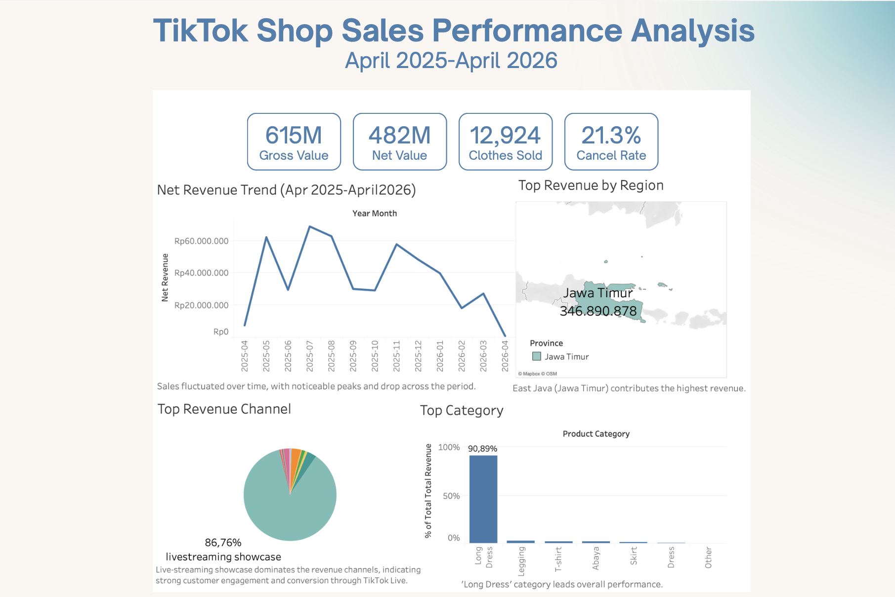

# TikTok-Shop-Sales-Analysis
E-commerce sales analysis using SQL, Python, and Tableau.

# 📊 TikTok Shop Sales Analysis

## 📌 Project Overview
This project analyzes TikTok Shop transaction data using Python and Tableau to identify sales performance, customer behavior, and cancellation trends.

## 🛠 Tools & Technologies
- Python
- SQL
- Tableau
- Pandas
- Jupyter Notebook

## 📂 Project Files

- tiktokshop_presentation.pdf
- tableau_charts.pdf
- Dashboard.png
- data_cleaning.ipynb
- data_analysis.ipynb

## 📊 Key Insights
- Fashion category generated the highest revenue
- Most order cancellations were caused by unpaid orders
- Customer purchases often occurred several days after product views
- Certain cities contributed significantly higher sales volume

## 📷 Dashboard Preview

## 📄 Reports
- [TikTok Shop Presentation](tiktokshop_presentation.pdf)
- [Tableau Charts](tableau_charts.pdf)

## 🧹 Data Cleaning Process
The dataset was cleaned using Python by:
- Removing duplicates
- Handling missing values
- Standardizing text categories
- Cleaning cancellation reasons

## 📈 Data Analysis
Analysis was performed to identify:
- Revenue trends
- Product performance
- Order cancellations
- Customer purchasing behavior

## 🚀 Project Purpose
This project was created as part of a data analytics portfolio to demonstrate skills in:
- Data cleaning
- Data analysis
- Data visualization
- Business insight generation

## 👤 Author
Erika Sientari
